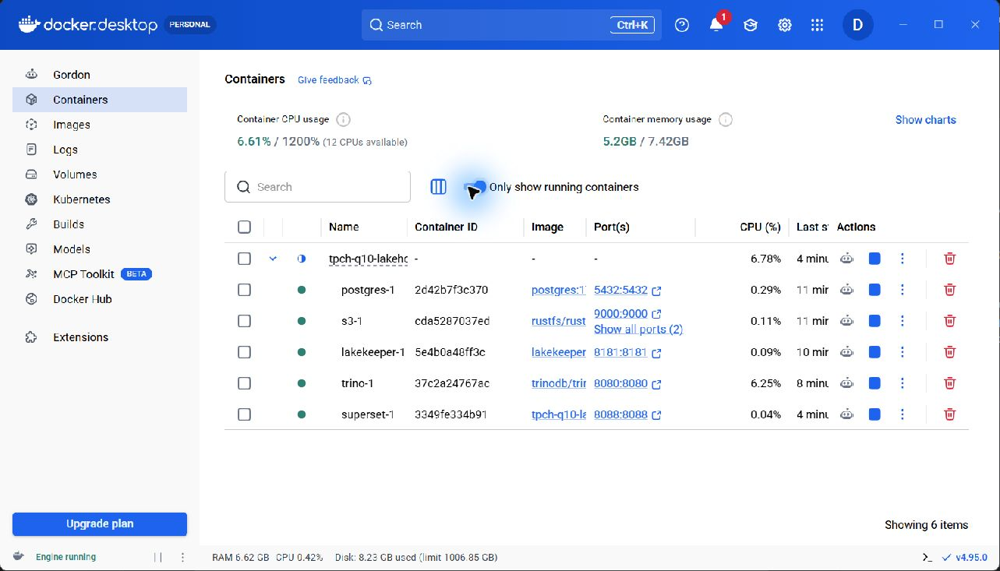
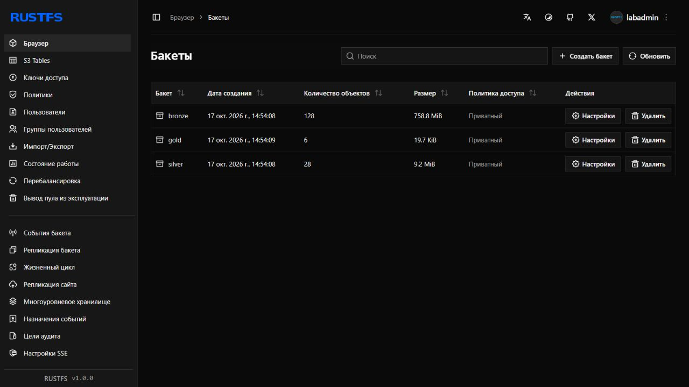
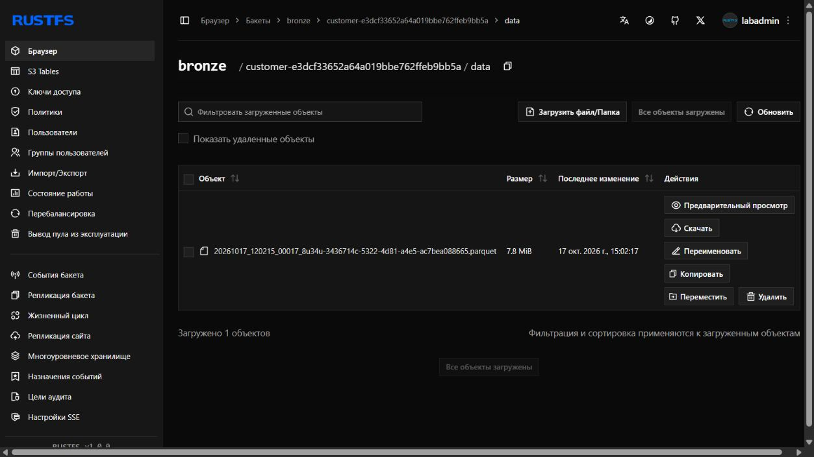
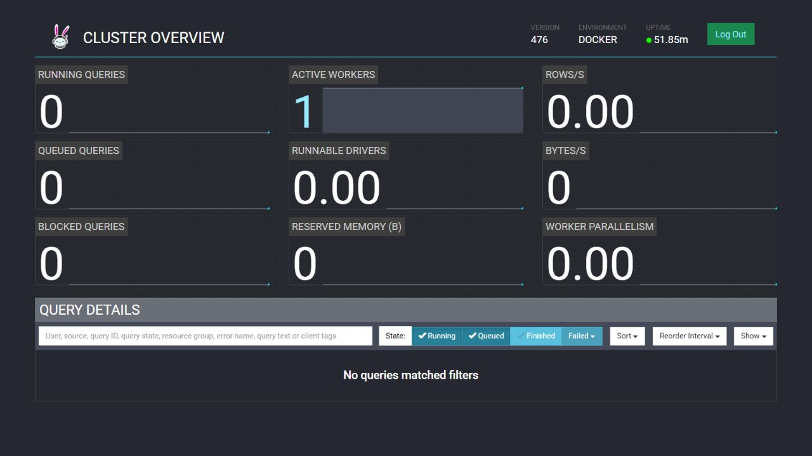
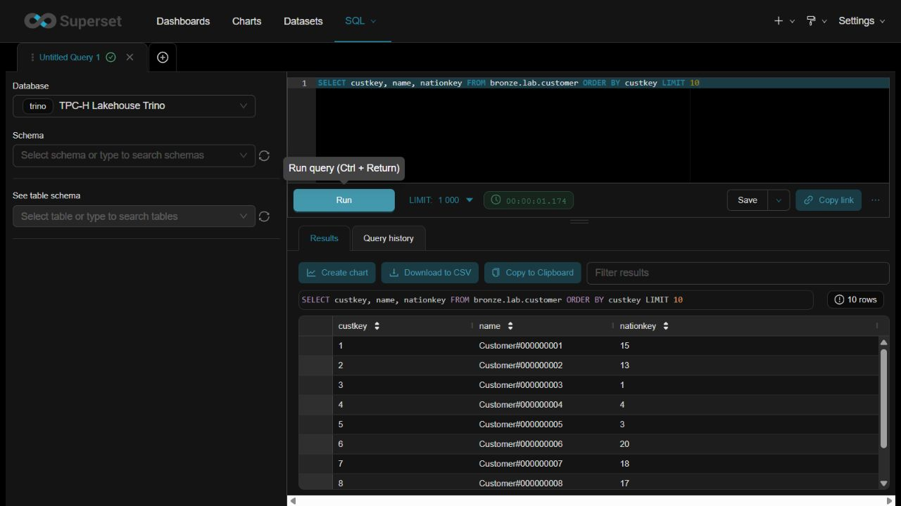

# Практическая работа № 1

## 1. Вариант и масштаб

Студентка: **Бикбулатова Динара Фануровна**. У меня вариант **2** и запрос TPC-H Q10 «Returned Item Reporting». Для работы взяла `tpch.sf1`, как указано в задании. Такой объём поместился на моём компьютере, и я смогла четыре раза записать одни и те же данные для сравнения форматов. В четырёх таблицах вместе **7 651 240 строк**.

## 2. Сервисы

| Сервис | Зачем нужен |
|---|---|
| RustFS | Хранит файлы в трёх S3-бакетах: `bronze`, `silver`, `gold`. Образ MinIO не скачался, поэтому я взяла совместимое хранилище. |
| PostgreSQL 17 | Хранит служебные данные каталога Lakekeeper. |
| Lakekeeper | Каталог Iceberg. Для каждого слоя в нём свой warehouse. |
| Trino 476 | Даёт исходные таблицы `tpch.sf1`, создаёт Iceberg-таблицы и выполняет SQL. |
| Superset 6.0.0 | Показывает данные Bronze через Trino в SQL Lab. |

Я запускала стенд из корня репозитория в PowerShell:

```powershell
py scripts/setup.py prepare
$runtime = 'D:\lakehouse-tpch-q10-runtime\runtime.env'
docker compose --env-file $runtime config --quiet
docker compose --env-file $runtime up -d s3 postgres lakekeeper
py scripts/setup.py bootstrap --accept-lakekeeper-terms
docker compose --env-file $runtime up -d --build trino superset
docker compose --env-file $runtime ps
py scripts/run.py
```

`prepare` создал пароли в папке `D:\lakehouse-tpch-q10-runtime`, вне Git. После принятия условий Lakekeeper появились три warehouse. Все обычные порты оказались свободны: RustFS — 9000 и 9001, PostgreSQL — 5432, Lakekeeper — 8181, Trino — 8080, Superset — 8088.

Работающие контейнеры:



Три бакета для слоёв:



## 3. Как работает Q10

Контрольный SQL из `варианты.md` я сохранила в [q10_control.sql](sql/q10_control.sql). Ему нужны четыре таблицы:

| Таблица | Нужные поля | Действие |
|---|---|---|
| `customer` | `custkey`, `name`, `nationkey`, `acctbal`, `address`, `phone`, `comment` | Данные клиента для вывода. |
| `orders` | `orderkey`, `custkey`, `orderdate` | Заказы с 1 октября 1993 года до 1 января 1994 года. |
| `lineitem` | `orderkey`, `linenumber`, `returnflag`, `extendedprice`, `discount` | Возвращённые позиции и сумма по каждой из них. |
| `nation` | `nationkey`, `name` | Название страны клиента. |

Я оставляю позиции с `returnflag = 'R'`, считаю для каждой `extendedprice * (1 - discount)`, складываю выручку по клиенту и беру 20 клиентов с самой большой суммой. Прямой Q10 вернул **20 строк**.

## 4. Bronze, Silver и Gold

У каждого слоя свой бакет и warehouse. В Bronze лежат все исходные строки, чтобы при необходимости можно было заново собрать следующие слои. В Silver я выделила данные, нужные Q10, и проверила их. В Gold записала готовую двадцатку клиентов.

### Bronze

| Таблица | Строк | Файлов | Размер файлов, МБ | Формат/кодек |
|---|---:|---:|---:|---|
| `customer` (все исходные колонки) | 150 000 | 1 | 8.201 | Parquet/ZSTD |
| `orders` (все исходные колонки) | 1 500 000 | 2 | 36.654 | Parquet/ZSTD |
| `lineitem` (все исходные колонки) | 6 001 215 | 8 | 154.379 | Parquet/ZSTD |
| `nation` (все исходные колонки) | 25 | 1 | 0.002 | Parquet/ZSTD |

Файл таблицы `customer` в бакете Bronze:



### Silver

| Таблица | Поля | Строк | Размер файлов, МБ |
|---|---|---:|---:|
| `customers_nation` | `custkey`, `name`, `acctbal`, `nationkey`, `nation`, `address`, `phone`, `comment` | 150 000 | 8.214 |
| `returned_items_q4_1993` | `orderkey`, `custkey`, `linenumber`, `extendedprice`, `discount` | 114 705 | 1.084 |

`customers_nation` хранит клиента вместе со страной, а `returned_items_q4_1993` — подходящие позиции заказов до суммирования. Так можно отдельно проверить цену и скидку. Обе таблицы записаны в Parquet/ZSTD.

### Gold

| Таблица | Поля | Строк | Размер файлов, МБ |
|---|---|---:|---:|
| `q10_top20` | `custkey`, `name`, `revenue`, `acctbal`, `nation`, `address`, `phone`, `comment` | 20 | 0.003 |

Gold записан в Parquet/ZSTD. Все **7 проверок** ключей, цены и скидки дали **0 ошибок**. Я сравнила Gold с прямым Q10 по всем полям: текст и ключи должны совпасть точно, выручка — до копейки. Для **20 строк** расхождений получилось **0**. Максимальная разница выручки до округления — **0,0000000003**. Запросы проверок лежат в [checks.sql](sql/checks.sql).

Партиции для `sf1` я не добавляла. У основной таблицы `lineitem` всего 8 файлов текущего снапшота, у `orders` — 2, у остальных — по одному. Для этого объёма и одного квартального запроса дробление по датам или странам только добавило бы мелкие файлы.

## 5. Тесты производительности

Я четыре раза записала одни и те же полные таблицы Bronze. Время записи — сумма четырёх `CREATE TABLE AS SELECT`. Перед пятью замерами Q10 был один прогрев. Время чтения я считала от отправки запроса до получения всего ответа. Размер — сумма `file_size_in_bytes` из Iceberg `$files` текущего снапшота. Точные значения и ID запросов есть в [measurements.json](results/measurements.json).

| Формат/кодек | Строк | Размер, МБ | Запись, с | Прогрев, с | Пять Q10, с | Медиана, с | Мин., с | Макс., с | Расхождения |
|---|---:|---:|---:|---:|---|---:|---:|---:|---:|
| Parquet/GZIP | 7 651 240 | 193.836 | 21.712 | 1.188 | 1.223; 1.014; 1.094; 1.166; 0.927 | 1.094 | 0.927 | 1.223 | 0 |
| Parquet/ZSTD | 7 651 240 | 199.236 | 19.097 | 5.512 | 1.849; 1.769; 1.235; 1.118; 1.266 | 1.266 | 1.118 | 1.849 | 0 |
| ORC/GZIP | 7 651 240 | 197.093 | 16.013 | 1.584 | 0.982; 0.983; 0.906; 0.902; 0.893 | 0.906 | 0.893 | 0.983 | 0 |
| ORC/ZSTD | 7 651 240 | 203.015 | 14.495 | 1.037 | 0.780; 0.846; 0.755; 0.771; 0.847 | 0.780 | 0.755 | 0.847 | 0 |

Parquet и ORC хранят данные по колонкам; GZIP и ZSTD сжимают данные внутри файлов. В моём запуске GZIP дал меньший размер, а ZSTD быстрее записался. Меньше всего места занял **Parquet/GZIP** — 193.836 МБ. Самая низкая медиана Q10 получилась у **ORC/ZSTD** — 0.780 с. Время может меняться из-за кэша и нагрузки на компьютер, поэтому я не считаю этот порядок универсальным. Все четыре результата Q10 совпали с контрольным по 20 строкам.

## 6. Lakehouse, изменение схемы, time travel и Superset

Файлы таблиц лежат в RustFS, Iceberg-метаданные — в Lakekeeper, запросы выполняет Trino. Я проверила, что через снапшот можно прочитать старое состояние таблицы.

Для этого я создала отдельную таблицу `silver.lab.schema_evolution_demo`. Сначала вставила одну строку, потом добавила `source_tag`, переименовала `note` в `description` и вставила строку с новым столбцом. ID старого снапшота — **4723588882722667086**. Запрос `FOR VERSION AS OF` вернул **1 строку** и столбцы `id`, `note`. Сейчас в таблице **2 строки** и столбцы `id`, `description`, `source_tag`. Gold в этом опыте я не трогала.

```sql
SELECT * FROM silver.lab.schema_evolution_demo
FOR VERSION AS OF 4723588882722667086
ORDER BY id;
```

Superset подключён к Trino через `trino://student@trino:8080/bronze`. В SQL Lab я выполнила `SELECT custkey, name, nationkey FROM bronze.lab.customer ORDER BY custkey LIMIT 10` и получила 10 строк.

Работающий Trino 476:



Результат запроса в SQL Lab:



## 7. Выводы

Я загрузила полный `sf1` и собрала из него Silver и Gold для Q10. Gold совпал с прямым запросом по всем 20 клиентам, а проверки ошибок не нашли. В моём тесте Parquet/GZIP занял меньше всего места, а ORC/ZSTD быстрее всего читал Q10 по медиане. На отдельной таблице я смогла поменять схему и прочитать прежний снапшот.
